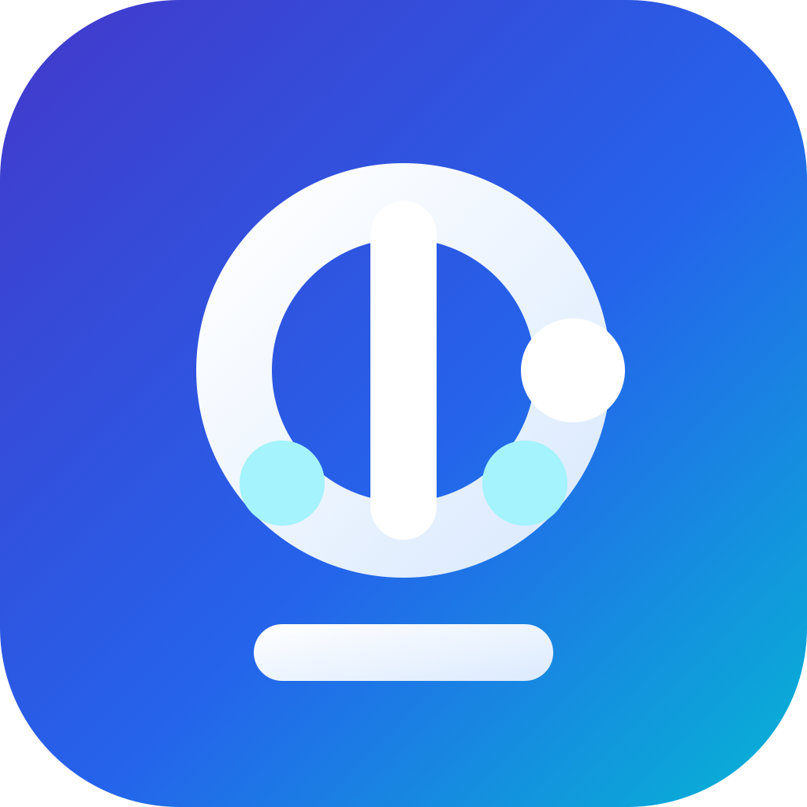
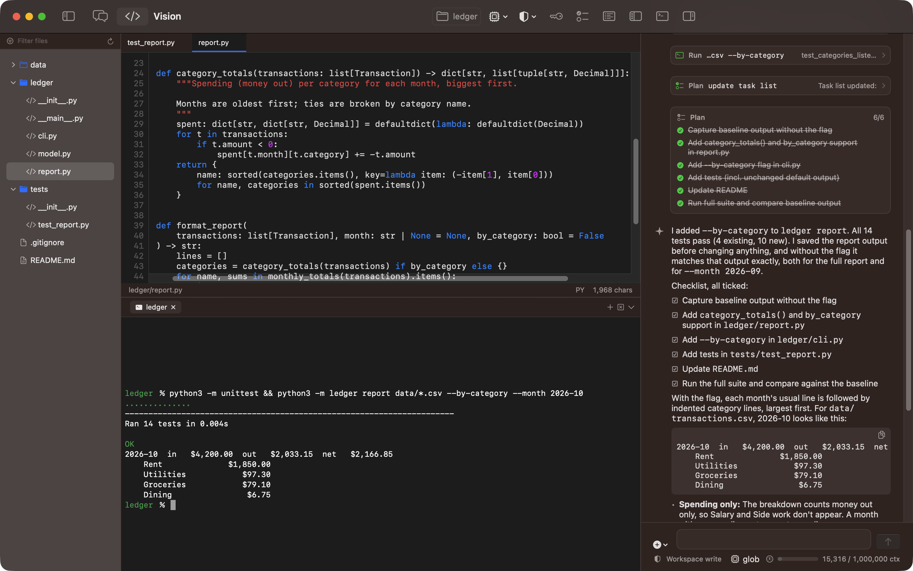

<p align="center">
  
</p>

<h1 align="center">Vision for macOS</h1>

<p align="center">
  A native SwiftUI coding agent that <em>is</em> the harness. It runs the tool loop itself and talks
  straight to an OpenAI-compatible model server — a DGX Spark or Strix Halo on your LAN, a local
  Ollama or LM Studio, a GLM, Kimi, Qwen or OpenAI plan — or Amazon Bedrock, and it can put several
  of them to work at once. No Node, no sidecar process, no web view.
</p>

<p align="center">
  
</p>
<p align="center">
  <em>Code mode</em> · <a href="assets/screenshots/chat.png">chat with its tasks</a> ·
  <a href="assets/screenshots/tasks.png">a /goal at work, with what is queued after it</a> ·
  <a href="assets/screenshots/prompts.png">the Prompts timeline</a> ·
  <a href="assets/screenshots/all-prompts.png">all prompts</a> ·
  <a href="assets/screenshots/activity.png">background activity</a> ·
  <a href="assets/screenshots/code-focus.png">code mode, chat and project status only</a> ·
  <a href="assets/screenshots/setup.png">the setup wizard</a> ·
  <a href="assets/screenshots/settings-models.png">Settings ▸ AI Models</a>
</p>

---

## What it is

Vision owns the agent loop end to end — there is no server process behind it:

```
you → VisionHarnessCore.Engine → OpenAI-compatible /chat/completions → tool calls → files & shell → you
```

So there is nothing to install alongside it and nothing to keep running. Point it at a model and start
chatting — or open a folder and it works on your code.

## Download

Grab the latest build from [Releases](https://github.com/phastings503cm/vision-mac/releases). The
`Vision.dmg` contains the app — drag **Vision** into **Applications**.

<!-- The README's one mention of the app's old name, so its users recognise it. Keep it to this sentence. -->
Vision was previously called DSH: its first launch brings over your chats, settings, keys and vault, and a
project's `.dsh` folder and `DSH.md` keep working.

> Releases are ad-hoc-signed for Apple Silicon (arm64), macOS 14+. Gatekeeper will prompt on first
> launch — right-click the app and choose **Open**, or run:
>
> ```bash
> xattr -d com.apple.quarantine /Applications/Vision.app
> ```

## Build

```bash
./bundle.sh release
open build/Vision.app
```

Requires Swift 6 / Xcode 26 and macOS 14+.

## First run

The setup wizard runs on first launch and is re-runnable any time from **Settings ▸ Run Again…** or
**Help ▸ Run Setup Wizard…**. Eight steps: pick a backend, enter its address (and key, if your
server wants one), prove the connection works, choose a model, set the context window and default
thinking level, pin a permission preset, and optionally open a project. Re-running it edits the
existing route in place, so headers and other settings survive.

Three choices on the backend page start a guide instead: **My Spark Swapper (DGX Spark or Strix Halo)**
sets a Swapper box up from one connection code, **A subscription or API plan — GLM, Kimi, Qwen, OpenAI**
shows where to get a key and checks it, and **Amazon Bedrock with my AWS account (guided)** signs you in
to AWS. Each is described below, and each is also under **Add** in **Settings ▸ AI Models**.

### Context window

Leave it on **Auto**. Every turn the app re-reads `GET /v1/models` — vLLM and SGLang both report
`max_model_len` there (1,000,000 for the Spark's YaRN serve, 524,288 for Qwen3.8 Flash at 512K) — so
the gauge and auto-compaction always budget against what the server is actually serving. If the
configured model id isn't served but the server serves exactly one model (a box that swaps models),
the app follows it and says so in the chat. Pick a fixed size only to cap the window lower. `/context`
shows the figure and where it came from.

### Switching models

The **model menu** under the composer shows the model in use and its window, and switches in one click:

- **<box> — what it serves**, one section per [Spark Swapper](https://github.com/gnubyte/DGX-Spark-Swapper)
  box: its models with their context window and speed ("27 tok/s measured here", or the published
  figure). Picking one asks *that* box to stop the current server and load the other; a banner above the
  composer tracks the steps, sending is paused while it switches, and when it's done every route on that
  box follows the new model and window automatically (OpenClaw is repointed by the swapper). Models the
  box knows but hasn't downloaded are listed as *Not installed* — install them from **Settings ▸ Model
  Servers**. `/swap` lists every box's models; `/swap flash` switches the box behind the primary (or the
  only box); `/swap evo flash` names the box by the start of its name.
- **Primary · Subagents · Backups · Other models**: every route that's switched on in **Settings ▸ AI
  Models**, each marked private (a lock) or masked (a shield). Picking one makes it the primary.

### Thinking

For reasoning models, the composer's **Thinking** menu (or `/think <level>`) sets how hard the model
thinks in that chat: Off · Low · Medium · High · Max, over a per-provider default set in the wizard or
Settings. On a self-hosted server it is sent as `chat_template_kwargs.enable_thinking` plus
`reasoning_effort` (top-level and in the template kwargs); hosted APIs get only `reasoning_effort`.
Templates disagree on vocabulary — Qwen3.8 accepts `low`/`medium`/`xhigh` and 400s on `high` — so
when a server rejects a word the client picks the nearest one it lists, retries once, and remembers
it. The model's reasoning streams live under the "Thinking…" row.

### Connecting a Spark Swapper

[Spark Swapper](https://github.com/gnubyte/DGX-Spark-Swapper) is the web control panel on a DGX Spark —
and, from Swapper 2.0, on an AMD Strix Halo box — that switches which model the box serves. Open its web
page, choose **Connect ▸ Connect Vision** and copy the connection code (`SSC1:…`). Then choose **My Spark
Swapper (DGX Spark or Strix Halo)** in the wizard, or **Add ▸ Spark Swapper (connection code)…** in
**Settings ▸ AI Models**:

1. **Paste the code.** It carries the box's name and addresses, its certificate's fingerprint, and an app
   token made for Vision — revoke it on the Swapper's Connect tab any time.
2. **Check it.** Vision goes on only if the box shows exactly the certificate the code names (a certificate
   your Mac trusts isn't enough), then reads what the box serves.
3. **Pick the model.** The box's models with context and speed, the one serving now preselected. Switch
   to another there and then — or install one the box hasn't downloaded yet (its size and how long it
   takes are shown) and **Switch to It** when it's done.
4. **How should Vision use it?** Primary, subagent or backup (see below) — and private, since it's your own
   hardware.
5. **Save and say hello.** The route is saved with the certificate pinned (the box's model server shows
   the same certificate), its key and the app token in your Keychain, and a first message goes through it.

**Settings ▸ Model Servers** lists every box: whether it's online, what it serves and its context, its
Swapper version and its models — installed or not, with **Install on <box>** — plus **Open Its Web
Page**, **Rename…** and **Remove**. A Swapper older than 2.0 (no Connect tab) connects there with
**Connect with an address and login instead** (the guide has the same link); its password goes to the
Keychain. A Spark set up in Settings ▸ Spark before 0.14 is carried over as the first box.

### Subscription plans: GLM, Kimi, Qwen, OpenAI

Choose **A subscription or API plan — GLM, Kimi, Qwen, OpenAI** in the wizard, or **Add ▸ Subscription
plan…** in **Settings ▸ AI Models**. The guide knows these plans, each with its International and China
addresses where it has both:

| Plan | Models |
|---|---|
| Z.ai — GLM Coding Plan | `glm-5.3` (1M context) |
| Z.ai — pay-as-you-go API | `glm-5.3` |
| Kimi Code (subscription) | `kimi-for-coding` (K2.8, up to 1M), `k3`, `k3-256k`, `kimi-for-coding-highspeed` |
| Moonshot (Kimi) — pay-as-you-go API | what `/models` lists |
| OpenAI API | what `/models` lists, the newest `gpt-*` chat model recommended |
| Qwen — Alibaba Cloud Coding Plan | `qwen3.7-plus`, `qwen3-coder-plus`, `qwen3-coder-next`, … |
| Qwen — Model Studio pay-as-you-go | what `/models` lists |

It walks you through getting a key for that plan (with a button to the right page, and the plan's
terms), takes the key — it goes to your Keychain — and catches recognisable mistakes, checks it
(`/models`, or a one-token message where a plan doesn't list models) with errors in plain words, lets you
pick the model, asks how Vision should use it, and says hello through it.

- **GLM-5.3 always thinks.** Vision never asks it not to; the thinking menu maps to its `low` / `high` / `max`.
- **Kimi Code checks which app is calling.** Vision tells it honestly that it is Vision
  (`User-Agent: Vision/<version> (macOS)`) and never imitates another tool. If Kimi turns it away, Vision
  says so and suggests the Moonshot API, which works with any app.
- **The Qwen Coding Plan is for interactive use only** under Alibaba's terms, so its route is marked
  *Interactive use only*: the Task Queue and `/goal` won't run while it's the primary.
- A ChatGPT Plus or Pro subscription doesn't include API access; the OpenAI API is billed separately.
- Every plan is an online service, so its route starts out **not private** (see below).

### Pointing it at a DGX Spark

Following the [DGX Spark AI setup guide](https://github.com/phastings503cm/dgx-spark-wizard), the box
serves an OpenAI-compatible API over your LAN. In the wizard choose **DGX Spark or another server on
your network** and give it the host and port:

| Field | Value |
|---|---|
| Address | the Spark's hostname or LAN IP (`spark.local`, `192.168.1.50`, …) |
| Port | `8002` for the guide's serving stack |
| URL | built for you as `http://<address>:<port>/v1` |

**Test Connection** calls `GET /v1/models`. If it succeeds the model list populates the next step; if
it fails you get the actual error plus the thing that is usually wrong — a server bound to `127.0.0.1`
instead of `0.0.0.0` is invisible from another machine.

The same step handles Ollama (`127.0.0.1:11434`), LM Studio (`127.0.0.1:1234`), OpenAI, and
OpenRouter. API keys go to your login keychain, never into the preferences file.

An agent needs a model that can call tools. Qwen3, Qwen2.5-Coder, and DeepSeek-V3-class models work;
very small models will flail.

### Several models: primary, subagents, backups

**Settings ▸ AI Models** has a row for every model you've added, with switches for what it does:

| Switch | Meaning |
|---|---|
| **On** | Vision may use it. Switched off, it stays in the list but is never used. |
| **Primary** | Answers you — the conductor. Exactly one. |
| **Subagent** | Takes side tasks from the primary, in parallel: the `agent`, `delegate` and background agents. |
| **Backup** | Takes over a turn when the primary doesn't answer. |
| **Private** | May see sensitive data; the others get it masked (next section). |

**Add** offers a Spark Swapper (connection code), a subscription plan, Amazon Bedrock, or any other
OpenAI-compatible server; **Test All** asks every model whether it answers and shows the result on its
row. The model menu in the toolbar and under the composer groups them the same way and makes any of them
the primary in one click.

- **Subagents** run on the subagent servers, least busy first and several at a time (the count is set per
  server), while the primary carries on. When every subagent server is busy, subagents may use the
  primary too (a checkbox turns that off). A server that stops answering is skipped for a minute and its
  task moves to another one (told, if the task had already changed things, to look before repeating a
  step). With a single server, a subagent waits out an outage as long as the main agent does.
- **A new primary** keeps the previous one working as a subagent server when a fleet is running, so two
  Sparks and Bedrock are still three servers afterwards, in different roles.
- **Backups.** If the primary fails before it has said anything — unreachable, timed out, key refused,
  model gone, rate-limited, a server error — the same request goes to each backup in order, and the chat
  says so: "Spark didn't answer (the server refused the connection), so this turn ran on Kimi Code." For
  the next minute the primary is tried last. If every backup fails too, the primary's error stands and the
  usual retries take over. A reply that has started is never switched mid-way, and subagents don't use
  backups — the fleet already moves their tasks.
- One self-hosted machine counts as one subagent server however many of its models are listed (a Spark
  serves one model at a time), and editing a route never makes it the primary.
- Each subagent server is asked which model it is serving *right now*, so a Spark that swapped models is
  still used correctly. A hosted service such as Bedrock serves every model at once, so a cheaper Bedrock
  model can take the side tasks while a stronger one leads.
- The bar above the composer shows where the running subagents are ("Spark 2 ×2 · Amazon Bedrock").
  A count is printed only when two or more subagents share a server, so a lone Bedrock agent is just
  "Amazon Bedrock". Expanded, the bar shows what each is doing, on which model; `/agents` lists the servers
  with how busy each is, and **Background activity** (⌥⌘A, below) shows every agent in every chat.
- A subagent on another route sends **that route's** temperature, output limit and thinking level (none set =
  its provider's default) — never the main chat's, which a Kimi or GLM server would refuse. A hosted worker
  whose key can't list models is still used with the model it is configured for. When a subagent doesn't run
  where its agent file asked, or a server was skipped on the way, its log says why.

### Private models and the sensitive-data shield

A model is **private** when it runs on hardware you control. Vision decides by its address — `localhost`, a
loopback, LAN, link-local or Tailscale (100.64/10) address, a one-word host name, or a name ending in
`.local`, `.lan`, `.home`, `.home.arpa`, `.internal` or `.ts.net` — and everything else, Amazon Bedrock
and every plan included, starts out *not private*. Flip the **Private** switch either way; your choice
wins.

Before a request goes to a model that isn't private, Vision masks what's sensitive in it — in the system
prompt, the messages, tool results, earlier tool calls and attached text files. Each value becomes a
placeholder such as `⟦EMAIL_1⟧` or `⟦SECRET_1⟧` (the same value always gets the same one), and once a value
has been found it is masked wherever it appears, even without the `password:` that gave it away. The model
is told to use the placeholders as written, and the real values are put back on your Mac as the answer
streams in — in its text, its reasoning and its tool calls. Your chats, files and tools only ever see the
real values, and no mapping is stored. A shield under the reply says what was masked: "Masked 2 emails and
1 key before sending to Kimi Code".

The **Sensitive data** section of **Settings ▸ AI Models** chooses what counts: secrets and keys (private
keys, cloud and API tokens, passwords in URLs and settings), email addresses, phone numbers, ID and card
numbers (card numbers and IBANs only when their check digits add up), IP addresses (off by default), and
your own **custom terms** — client or patient names, project code names, one per line, `re:` for a
regular expression; they are kept in your Keychain, not the settings file. A type (`"password": "string"`) or a
reference to another variable (`$DB_PASSWORD`, `%TOKEN%`) isn't taken for a secret. Secrets in the Credentials
Vault are always masked. **Try it** shows exactly what a
model that isn't private would receive. Pictures and files that aren't plain text (a PDF, say) can't be
checked; the chat says so the first time it sends one to a model that isn't private.

When there are subagent servers, the primary is told which are private and to describe tasks for the
others in general terms. A task marked `sensitive` runs only on a private server; if none can take it, the
model is told to do it itself.

### Using Amazon Bedrock

On the wizard's backend page choose **Amazon Bedrock with my AWS account (guided)** — or **Settings ▸
AI Models ▸ Add ▸ Amazon Bedrock…** — for a guide written for people who have never used the AWS CLI. All it
needs is an AWS account you can sign in to on the website.

1. **The AWS CLI.** Vision looks for it (on your `PATH` and in `/usr/local/bin`, `/opt/homebrew/bin`,
   `~/.local/bin`, `~/aws-cli`) and installs it if it's missing or too old for the browser sign-in (2.32
   or later): Amazon's official installer package, downloaded from `awscli.amazonaws.com`, its signature
   checked with `pkgutil` (a Developer ID installer certificate from Amazon's Apple team, `94KV3E626L`),
   installed for you alone under `~/aws-cli` — no administrator prompt — with `aws` linked from
   `~/.local/bin`. If that's blocked it can install for everyone (macOS asks for your password) or with
   Homebrew.
2. **Sign in.** Pick a Region, then **Sign in with AWS**: Vision runs `aws login` into its own profile,
   `vision-bedrock`, so profiles you already have are left alone. Your browser opens the AWS sign-in page;
   Vision never sees your password. Already set up with IAM Identity Center (SSO), keys or a role? Choose
   **an AWS CLI profile I already have** — Vision runs `aws sso login` for SSO profiles.
3. **Pick a model.** The Region's chat models (Claude, Amazon Nova, Llama, Mistral, DeepSeek, …), the best
   of each family first, using a cross-Region inference profile where the model needs one. Search by
   name, switch Region without leaving the page, and see at a glance which models are ready to use.
4. **Enable it** — only when needed; most models are ready immediately:
   - **Claude** needs Anthropic's one-time *use case* form per AWS account. Vision asks the same questions
     (company, website, industry, who will use it, what for) and submits it.
   - **Marketplace models** show their offer first — price per unit, licence (EULA) link, refund policy —
     and are enabled only after you tick *I accept* and press **Accept and enable**.
   - Then Vision waits for AWS to finish (usually seconds, up to 15 minutes for a new subscription). If your
     AWS identity isn't allowed to do something, the page says which permission is missing and has a
     ready-made IAM policy to copy for your administrator.
5. **Connect** — saves the route (profile, Region, model), says hello through Bedrock, and asks whether
   the model should lead (main model) or take subagent tasks.

Requests are signed with SigV4 using short-lived credentials the AWS CLI exports for the profile
(`aws configure export-credentials`), refreshed before they expire; nothing secret is stored in Vision's
settings. Chats use Bedrock's Converse API with streaming, tools, images, prompt caching for Claude and
Nova, and Claude's extended thinking. When the sign-in runs out, the banner offers **Sign in to AWS…**;
**Settings ▸ AI Models** has **Sign in** and **Change…** (another model, Region or account) for each Bedrock
route, and the model menu has **Choose a Bedrock Model…**.

Costs are billed by AWS to your account (Amazon Bedrock, and AWS Marketplace for Marketplace models).
To remove Vision's sign-in: `aws logout --profile vision-bedrock`.

## Tools

The tool set matches [Qwen Code](https://qwenlm.github.io/qwen-code-docs/en/developers/tools/introduction/)
name for name, so prompts, skills, and habits from that ecosystem carry over:

| Tool | What it does |
|---|---|
| `read_file` | read a text file, with line numbers |
| `read_many_files` | read a batch in one call |
| `write_file` | create or replace a file |
| `edit` | replace an exact string inside a file |
| `list_directory` | list one directory |
| `glob` | find files by pattern (`**/*.swift`) |
| `grep` | search file contents |
| `run_shell_command` | run a command in the project folder |
| `web_fetch` | fetch a URL as text |
| `todo_write` | publish a task list the UI renders |
| `exit_plan_mode` | hand back a plan instead of doing the work |
| `agent` | a subagent for a scoped task; `agent_type` picks the kind (`general`, `explore`, `plan`, `review`, `worker`, or your own agent file), `run_in_background` keeps it working while you carry on, `sensitive` keeps it on a private server |
| `delegate` | hand out a list of independent tasks and get every report back together; with several model servers they run on different machines |
| `use_skill` | load one of your skills when the task matches it |

**Models without function calling still work.** Many Qwen-class models on Ollama or older vLLM emit
tool calls as XML inside plain text instead of `tool_calls`. When a turn finishes with no native
calls, the text is run through an XML parser that understands both the `<function=…>` and
`<tool_name>…` conventions, and the recovered calls execute normally.

### Since 0.8

- **Live processes and the machine** (0.8). `process_start`, `process_read`, `process_write`, `process_stop` and `process_list` talk to a running program. `screenshot`, `list_windows`, `screen_watch`, `ui_tree`, `inspect_process`, `mouse`, `keyboard`, `focus_app` and `view_image` look at and drive the Mac.
- **Task Queue** (0.9; unattended since 0.10). `queue_task` adds follow-up work; `/queue` runs the queue one task at a time. A model outage retries until the server is back.
- **Credentials Vault** (0.11). API keys and passwords live in the Keychain. The agent references a secret by its vault name and never sees the value; `vault_search` lists names, not secrets.
- **Background subagents** (0.12). `agent` with `run_in_background` (up to four per chat), plus `agent_status` and `agent_stop`.
- **Turn phases** (0.16). Every turn runs Planning → Execution → Validation → Results. Planning drafts the plan live and states an ETA — classified into a small task catalog, scoped to the ask, and blended with how long turns of that kind took before (the cache persists and refines as turns complete; Guardian aggregates the same learning across its users). Execution shows a green working badge with the runtime against the estimate, and every step timestamped when you drill in. When the work ends, validation checks the outcome against the plan the turn set out with and gathers evidence — screenshots, changed files, the closing summary — or loops back to execution when it fails (unlimited by default, cappable). Results shows a green "completed with results" with the evidence. Works with `/goal` and the task queue.
- **Prompt history** (0.16). Every prompt a chat has sent, with its outcome chip and timestamp: copy it, reuse it in the composer, and see the results card it produced.
- **Guardian** (0.16). Sign in with your guardian.503cm.com login and use your account's models through its OpenAI-compatible proxy — a wizard option and a Settings ▸ Guardian tab. Prompts you send sync to Guardian's prompt history; skills, chats and code projects move both ways (deposit/take skills, export/import chats, upload a project to the account's private repo store for the AI Coders module).
- **The machine-in-use glow** (0.16). While a computer-use tool is on the machine — observing or controlling it — the screen edges glow green with "machine in use by Vision AI". It takes no input and goes away when the tool ends.

## Code mode

**⌘2** switches the window from chat to a VS Code-shaped workspace, with the agent in the panel:

- **Project tree** — lazy, filterable, FSEvents-backed. New files from a build or from the agent show
  up without a refresh. Right-click for reveal, rename, new file/folder, trash, open a terminal here,
  or drop the path into the chat composer as `@path`.
- **Editor** — tabbed `NSTextView` with a line-number gutter, soft tabs, indent-preserving newlines,
  find bar, and a syntax highlighter covering the usual languages. Highlighting is scoped to the
  visible range, so a 20 000-line file opens as fast as a short one.
- **Live reload** — when the agent rewrites a file you have open, a clean buffer just follows it. A
  buffer with unsaved edits never gets overwritten: it raises a bar offering **Reload from Disk** or
  **Keep Mine**.
- **Terminal** — a real login shell on a pty (`forkpty`, so job control and Ctrl-C work), with a
  VT100/xterm-subset emulator: colour including 256 and truecolor, scroll regions, the alternate
  screen, and OSC titles. Multiple tabs, each rooted where you opened it. **⌃`** toggles the panel.

**The chat comes first.** The file tree (⌘B), the editor (⌥⌘E), the terminal (⌃`) and the agent beside
the editor each have a toolbar toggle (lit while showing) and a View menu item. With the editor and
terminal hidden, the chat takes the middle of the window and a **project status** panel sits beside it:
the branch and the changed files from git (click one to open it), the selected chat's run — its phase,
runtime against the estimate, and the model and server — its plan with the subagents on each step, what is
queued next, and the agents working. **⌥⌘↩** hides everything but those two. Opening any file brings the
editor back in the middle. A project opened for the first time starts with the chat as the main view.

Open tabs, the terminal panel, and which panes show are remembered per project.

## Chat

The transcript interleaves messages and tool calls in the order they happened — a tool card renders
between the text that preceded it and the text that followed, expandable to its full output. Markdown
renders with headings, fenced code (with copy), lists, task lists, quotes, and tables, including an
unterminated fence while a response is still streaming.

The composer sends on ↩ and inserts a newline on ⇧↩. The **+** menu attaches an image or a file.
Files the turn touched appear as chips that jump straight to the editor.

### Chats without a project

A chat doesn't need a folder. With no project open — or with **File ▸ New Chat Without a Project**
(⇧⌘N), or the speech-bubble button in the sidebar while a project is open — it's a regular conversation:
the model answers directly, never asks you to open a folder, and uses tools only when they help. When
something needs files or commands — a skill that runs a script, a document to draft — it works in the
chat's own folder, `~/Library/Application Support/Vision/Chats/<chat id>`, which the permission preset
confines it to just as it would a project folder. Deleting the chat deletes the folder; **Reveal Chat
Folder in Finder** is on the chat's right-click menu. Your own instruction files and skills apply (shown
as "Using the deploy skill" when the model loads one); the open project's don't. A task such a chat puts
on the Task Queue works in the same folder.

### Tasks: what the chat is doing, and what comes next

**⇧⌘P** — or **Tasks** in the toolbar — opens the right column on the chat's tasks, in chat and code mode.
The **first task is always what the chat is doing now**: the prompt, `/goal` or queue task, its phase,
round and runtime against the estimate, a Stop button, and its plan's steps with progress — each step
showing the subagents working it, by name and model ("worker · Qwen3-Coder on DGX Spark"). Idle, it shows
how the last prompt ended and the plan it left.

Below it is **Up next**. The composer stays usable while the agent works: **↩** adds the draft to the
chat's tasks (**⌘↩** does so any time), and each task starts by itself, in order, when the work before it
ends — sent exactly as if you had sent it then, so a `/goal` stays a goal and a command just runs. Drag or
use the arrows to reorder, edit, remove, or run one next; the list keeps taking new tasks while it moves.
A Stop, a failure, or a goal that needs you **pauses** the list (Resume carries on), and waiting tasks are
paused when Vision opens again. Finished tasks are listed with **Run again**. Chat tasks never run
unattended on the Task Queue, which stays the place for work across projects.

The column opens by itself when the agent first makes a plan, unless you untick **Show when the agent makes
a plan**; drag its edge to resize it.

### Prompts: everything you asked, and how it ended

**⇧⌘H** — or **Prompts** in the toolbar, or the line under the last result — lists every prompt the chat
has sent, newest first under day headings: when, what, and how it ended (**Completed with results**,
Completed, Finished with issues, Needs you, Failed, Stopped, Running, Queued), how long it took against its
estimate, attempts and evidence. Search it; open a prompt to **Copy** it, **Add to composer** (a quote
with when it ran and how it ended, to talk about it), **Jump** (the chat scrolls to it and flashes it) or
see its **Results** — timing, attempts, rounds, kind, the model and server it ran on, tokens, the evidence
and the completion notes. **All Prompts** (⌥⇧⌘H) does the same across every chat on this Mac, filterable
by outcome. The timeline is kept per chat in `prompt-timeline/<chat id>.json`; chats from before it existed
are filled in once from their transcripts.

### Background activity

**⌥⌘A** — or the bolt in the toolbar, which counts what is working — lists everything working right now,
in every chat: each chat's main agent, its subagents and background agents, the Task Queue, and chats
with tasks waiting. Each shows the model and server it runs on, what it was given (the plan step, the
prompt, the task), its status, how long it has run, its steps and tokens. Open a subagent's log — where it
ran and why, the task it was given, every stamped step, its report — or stop it. The model servers' load is
at the bottom.

### Slash commands

| Command | What it does |
|---|---|
| `/goal <task>` | Works on the task round after round until the model ends a reply with `GOAL_COMPLETE` (or `GOAL_BLOCKED: …` when it needs you). The goal is restated every round so it survives compaction. There is no round cap. ⌘. stops it. |
| `/queue` | Starts the task queue. It works queued tasks one at a time, unattended. |
| `/compact [focus]` | Summarizes the conversation now, keeping a short recent tail. Earlier messages stay visible above the divider; the model carries the summary. |
| `/think off\|low\|medium\|high\|max\|default` | Thinking level for this chat. |
| `/context` | Window size, usage, and where the window figure came from. |
| `/swap [box] [model]` | Lists every Swapper box's models, or switches what one serves — the box behind the primary unless you name one. |
| `/agents` | The kinds of subagent, the model servers they run on with how busy each is, and what is running now. |
| `/skills` · `/skill <name>` · `/skill new <what>` · `/<name> args` | Skills: list, select for this chat, have the model write one, or run one. |
| `/help` | Lists these. |

Long chats also compact automatically at 75% of the window (keeping up to ~96K recent tokens verbatim),
including in the middle of one long tool-heavy turn.

## Memory and knowledge files

Because this app assembles the prompt itself, instruction files are simply read and injected — no
mirroring into `AGENTS.md`, no managed marker blocks. Any of these in the project root is loaded on
every turn, in order:

`AGENTS.md` · `QWEN.md` · `CLAUDE.md` · `.claude/CLAUDE.md` · `CLAUDE.local.md` · `.cursorrules` ·
`VISION.md` · `MEMORY.md` · `memory/YYYY-MM-DD.md`

A chat without a project reads the same files from your home folder instead (`~/AGENTS.md`,
`~/MEMORY.md`, …), and **Memory & Skills** shows those for it.

**Session ▸ Memory & Skills… (⇧⌘M)** edits them and shows the **System prompt** tab — exactly what
gets sent. **Set Up Memory** scaffolds `MEMORY.md` plus today's daily log. The editor warns past ~100
lines, because that file costs tokens on every request — detail belongs in a skill.

## Skills

A skill is packaged instructions the agent loads when a task matches: a folder with a `SKILL.md`
(frontmatter `name` + `description` saying *when* to use it, then Markdown) and optional bundled files.
The format is shared by Claude Code, Cursor and the Agent Skills convention, so Vision **reads their
folders in place** and can **import from and export to** any of them.

| Read in place | Where |
|---|---|
| Vision | `<project>/.vision/skills`, `~/Library/Application Support/Vision/skills` |
| Agent Skills / Qwen Code | `.agents/skills`, `~/.agents/skills`, `.qwen/skills` |
| Claude Code | `.claude/skills`, `.claude/commands/*.md` (slash commands), `.claude/rules/*.md`, and the `~/.claude` equivalents |
| Cursor | `.cursor/skills`, `.cursor/rules/*.mdc` (`alwaysApply`, `globs`, `description`), `~/.cursor/skills`; `.cursorrules` is loaded as project instructions |

Same-named skills resolve by precedence (project Vision first, then the other project folders, then
yours); the loser is shown as *Overridden*. Rules with `alwaysApply` are always in the prompt;
rules with `globs` are offered with the files they apply to; Claude commands run when you type `/name`.

**In a chat** — the **Skills** button under the composer lists every skill with search. Tick the ones
this chat should use: their full instructions go into the prompt. Untick **Let the model choose
skills** to make it use only what you ticked; leave it on and the model sees each skill's description
and loads the right one itself (`use_skill`). `/skills` lists them, `/skill <name>` toggles one, and
`/<name> args` runs a skill or command directly (`$ARGUMENTS`, `$1`…`$9` are filled in).

**Settings ▸ Skills** manages them all: switch any skill on or off, edit your own (Claude/Cursor files
are copied into Vision before editing, so nothing of theirs is changed), move to Trash, and choose which
foreign layouts to read.

- **Generate.** *New ▸ Write with AI* (or `/skill new <what it should do>` in a chat, which can distil
  the conversation itself into a skill) has the model write a `SKILL.md`, which you review and edit.
  The agent can also propose a skill mid-task with `propose_skill`.
- **Approve.** Nothing generated or proposed is active until you approve it. Drafts wait under
  *Awaiting your approval* — review, edit, choose project or everywhere, then Approve or Reject. A
  linter flags a missing description, an over-long body, and anything that looks like a secret.
- **Import.** From a folder (a skills folder, `.claude`, `.cursor`, or a whole project), a `.zip`, a
  `.md`/`.mdc` file, or an https link (GitHub repository or `…/tree/<branch>/<folder>`). You see what
  was found — skills, rules, commands, `CLAUDE.md`/`AGENTS.md`/`.cursorrules` — tick what to import,
  and choose activate-now or send-to-review. Scripts are flagged and never run by importing;
  symlinks are never followed; archives with unsafe paths are refused; size limits apply.
- **Export.** As a zip or written into a folder, as portable skill folders, Claude Code
  (`.claude/skills`), Cursor (`.cursor/rules/*.mdc`, skills with files as `.cursor/skills`), Agent
  Skills, or Vision's layout.

## Plugins

A plugin is a JSON manifest that declares extra tools backed by shell commands. No compilation, no
process protocol — drop a file in `~/Library/Application Support/Vision/plugins/` or
`<project>/.vision/plugins/` and hit Reload in **Settings ▸ Plugins**.

```json
{
  "name": "swift",
  "description": "Swift package helpers",
  "tools": [
    {
      "name": "swift_test",
      "description": "Run the package test suite. Use after changing code.",
      "parameters": {"type": "object", "properties": {"filter": {"type": "string"}}},
      "command": "swift test --filter ${filter}",
      "requiresApproval": false
    }
  ]
}
```

`${key}` interpolates an argument, shell-quoted, so a value containing spaces or `;` cannot break out
of its position. `requiresApproval` defaults to **true** — a plugin runs arbitrary shell, and silence
is the wrong default. A plugin tool may not shadow a built-in.

## Permissions

The shield in the toolbar sets the preset new chats start with; a chat keeps the preset it was
created with.

| Preset | Files | Shell |
|---|---|---|
| **Workspace write** | reads anywhere; writes inside the project proceed, outside it asks | mutating commands ask |
| **Plan only** | reads anywhere; every write asks | every command asks, and the agent is told to produce a plan |
| **Full access** | writes anywhere without asking | runs without asking |

A gate appears inline above the composer with the exact path or command. Denying it writes the
refusal into the transcript as the tool's *result*, along with an instruction not to retry — without
that, models generally attempt the same write three more times.

## Stopping

A running agent is reachable without opening its chat: the running bar at the top of the sidebar
(with Stop All), a stop button on the chat's own row, the toolbar, and **Session ▸ Stop Turn (⌘.)** /
**Stop All Agents (⇧⌘.)**. Running chats sort to the top of the sidebar.

## Talking to Guardian

Guardian (guardian.503cm.com) is the account side of the family — models, prompts, skills, chats and code, shared across your harnesses.

**Connect**: the wizard's *My Guardian account* choice, or Settings ▸ Guardian. Sign in with your Guardian email and password; Vision exchanges them for a session token (Keychain, not preferences) and lists the models your plan allows. The route behaves like any OpenAI-compatible server — primary, subagent, backup, thinking levels — with Guardian doing the proxying.

**What syncs**:

| | Direction | When |
|---|---|---|
| Prompt history | harness → Guardian | automatically, as you send prompts while signed in, and again with the outcome when each ends |
| Prompt history | Guardian → harness | Settings ▸ Guardian browses the account's notebook |
| Skills | both ways | import the account's skills; deposit the project's `.vision/skills` |
| Chats | both ways | export all loaded chats; import the account's exported ones back |
| Code projects | harness → Guardian | upload the open project's text files to the account's private repo store — Guardian's own github-for-one, ready for the AI Coders module |

**Estimates across users**: the turn-phase ETA cache that Vision keeps per machine (`eta-cache.json`) has a multitenant big sibling in Guardian, which aggregates durations per task kind and scope across its users — the client sends nothing but the kind, the scope number and the wall-clock.

## Architecture

```
VisionHarnessCore/         the harness. No AppKit, no SwiftUI — headlessly testable.
  Engine.swift             the agent loop: stream → tool calls → results → repeat
  Models.swift             provider-neutral wire shapes, provider profiles
  OpenAIClient.swift       SSE streaming against any /v1/chat/completions
  XMLToolCalls.swift       tool-call recovery for backends without function calling
  Tools.swift              executor protocol + registry
  FileTools.swift          read_file, write_file, edit, list_directory
  QwenTools.swift          glob, grep, read_many_files, exit_plan_mode
  CommandTools.swift       run_shell_command, web_fetch, todo_write
  AgentTool.swift          subagents (agent types, failover across servers) and delegate
  Fleet/                   AgentFleet (servers, leases, health, private servers), roster, agent definitions, delegate
  ProviderClients.swift    one factory: OpenAI-compatible routes and Amazon Bedrock, with backups and the shield
  FailoverClient.swift     backups for the primary
  SensitiveData.swift      the shield's detectors: secrets, emails, phones, IDs and cards, IPs, your terms
  ShieldClient.swift       masking before a request goes out, restoring as the answer streams in
  RoutePrivacy.swift       which addresses are private by default
  CertificatePinning.swift SHA-256 certificate pins for self-signed servers
  SparkSwapper.swift       the Spark Swapper client: status, switching, installs, tokens, connection codes
  SwapperConnections.swift Swapper boxes, their Keychain secrets, signing in, /swap
  PlanCatalog.swift        the subscription plans: addresses, key pages, models, errors in plain words
  ChatPrompt.swift         the prompt and scratch folder of a chat without a project
  AWS/                     SigV4, event streams, the AWS CLI (run, sign in, install), Bedrock setup
  Bedrock/                 the Converse client, its request mapping and per-model table
  Permissions.swift        presets, path containment, shell gating
  Plugins.swift            JSON manifests → tools
  ProjectContext.swift     instruction files, memory, skill catalog, prompt assembly
  PTY.swift                forkpty + a shell
  TerminalEmulator.swift   VT100/xterm-subset screen
  EditorBuffer.swift       open file, dirty tracking, external-change resolution
  Language.swift           lexical vocabulary per language
  Markdown.swift           block parser (SwiftUI only does inline)

VisionMacApp/              SwiftUI
  VisionMacApp.swift       @main, menus, root split view, toolbar
  AppModel.swift           project, mode, sheets
  AppTransport.swift       engine per session, events → timeline, plugins, context
  SessionVM.swift          one ordered timeline of messages, tool calls, and todos
  ConversationLog.swift    per-session JSON transcripts
  SetupWizard.swift        first-run configuration
  ModelRoutesSettings.swift  Settings › AI Models: a row per route (on, primary, subagent, backup, private)
  SensitiveDataSettings.swift  Settings › AI Models › Sensitive data
  SwapperSettings.swift    Settings › Model Servers: the Swapper boxes
  SparkController.swift    the boxes: status, switching, installs, routes that follow
  RouteMenu.swift          the primary / subagents / backups menu shared by toolbar and composer
  PlanPanel.swift          the plan panel
  Swapper/                 the "Connect my Spark Swapper" guide
  Plans/                   the subscription plan guide
  Bedrock/                 the Amazon Bedrock guide, its model picker and its backend
  ChatView.swift           transcript, gates, composer
  CodeModeView.swift       tree | editor + terminal | agent
  CodeEditor.swift         NSTextView, line-number ruler
  TerminalView.swift       grid rendering, selection, key encoding
  FSWatcher.swift          FSEvents over the project
```

`VisionHarnessCore` has no UI dependency, so the whole harness is verifiable on its own:

```bash
swift test
```

1,490 tests: the engine loop (tool round-trips, denials, iteration budget, usage accounting,
cancellation), permission containment, the Qwen XML fallback, glob, markdown, plugin interpolation
and quoting, prompt assembly, editor-buffer conflict resolution, 34 over the terminal emulator, and 8
that spawn a real shell on a real pty and assert on what lands on the screen — plus the fleet (server
choice, failover, agent types, `delegate`), the AWS layer (SigV4 and Bedrock API keys against
botocore's own values, the event stream, the CLI runner driven through stand-in `aws` scripts, sign-in,
the installer), Amazon Bedrock (request mapping, streaming, every error path, the model catalog and
access checks), the Bedrock guide as a state machine over a scripted AWS, the Spark Swapper client
(connection codes, app tokens, installs) and its guide, certificate pinning, the subscription plans and
their guide, privacy by address, the shield's detectors and its masking and restoring (placeholders split
across streamed pieces, values with quotes and emoji inside tool calls, a value found once masked everywhere,
8,000 CSV rows in well under half a second), backups, sensitive tasks on
private servers, chats without a project, the first launch's move of the data folder, settings and
Keychain items from the app's old name (with a crash replayed after every step), the keyboard tool's key
codes against the system's own, and the app host against two fake model servers — including the Prompts
timeline (every ending, timing against the estimate, search, the composer quote, Jump after a relaunch, the
backfill of old chats, the file), chat tasks end to end (in order after the current work, paused by a Stop or
a failure and at launch, goals and commands as tasks), and which model, route and settings a subagent really
uses, checked on the wire. Four live tests are skipped unless pointed at a real server.

## Status

Verified on macOS 14+ / Apple Silicon:

- Setup wizard, provider discovery against a live `/v1/models`, keychain round-trip
- Chat transcript with interleaved tool cards, markdown, tables, and streaming
- Code mode: tree, tabs, syntax highlighting, line numbers, status bar
- Integrated terminal against a real `zsh` — output, cwd, `stty size`, SIGWINCH on resize, exit
  status, and ANSI colour, each asserted by a test
- Live reload and the unsaved-edits conflict path
- Permission gates, denial recorded as a tool result

### Known gaps

- **The terminal is a subset, not a full VT.** Shells, build logs, `git`, and `less` are fine; a
  full-screen curses app that relies on mouse reporting or sixel is not.
- **Amazon Bedrock, the multi-server fleet, backups and the subscription plans are covered by tests
  against fakes** (a scripted AWS CLI, stubbed HTTP, fake model servers); the Swapper client was also run
  against a local Swapper 2.0 demo. The first run against real AWS, a real plan, and a real second box is
  yours.
- **The shield masks what it recognises** — the patterns above and your own terms — not every name or
  detail in a conversation. Describe tasks for a model that isn't private in general terms, as the agent
  is told to.
- **Reasoning is shown live but not kept** in the transcript once the answer arrives. Servers
  without a reasoning parser leave `<think>` text inline in the answer.
- **Search across sessions is not implemented.** Transcripts are plain JSON under
  `~/Library/Application Support/Vision/conversations/`, so `grep` works in the meantime.
